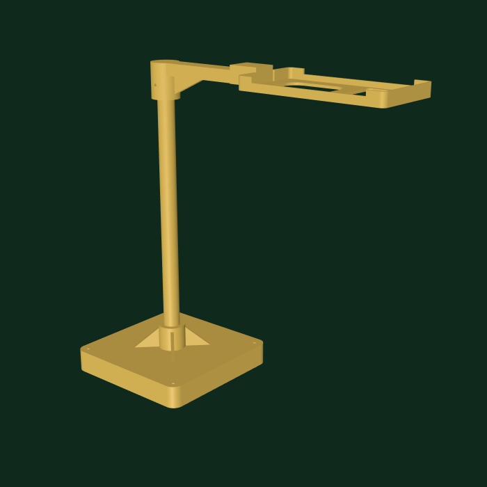

# 📷 Handy-Halterung für die Kamera-Erkennung

Das Handy liegt mit dem **Display nach oben** in der Ablage, die Rückkamera schaut durchs Fenster senkrecht auf die Würfel – aus ca. **37 cm Höhe**, rund **28 cm** neben der Säule (Säule und Fuß bleiben aus dem Bild).
Ausgelegt für das **Samsung Galaxy S26 Ultra mit Hülle**; andere Handys: Maße oben in `halterung.py` ändern und neu erzeugen.



## Teile (`stl/`)

| Datei | Anzahl | Ausrichtung beim Druck | Infill |
|---|---|---|---|
| `1_fuss_unterteil.stl` | 1 | Öffnung nach oben | 15 % |
| `2_fuss_deckel.stl` | 1 | Platte unten | 20 % |
| `3_saeule.stl` | **3** (2 = niedriger, ca. 25 cm) | stehend, Zapfen oben, mit Brim | 30 %, 4 Wände |
| `4_arm.stl` | 1 | wie in der Datei (Kappe unten) | 30 % |
| `5_ablage.stl` | 1 | Boden unten | 20 % |

PLA oder PETG, 0,2 mm Schichthöhe, 3 Wände, **keine Stützen nötig**. Alle Teile passen auf ein 220 × 220 mm Druckbett.
Filament gesamt: ca. 250 g.

## Zusammenbau

1. **Fuß beschweren:** Unterteil mit ca. **600–800 g** Sand, Reis oder Münzen füllen (z. B. in einem Gefrierbeutel).
2. **Deckel** aufsetzen – die vier Stifte greifen in die Löcher.
3. **Säulenteile** mit dem Zapfen **nach unten** zusammenstecken und in die Hülse im Deckel stecken.
4. **Arm** oben auf die Säule stecken, **Ablage** auf den Zapfen am Arm schieben.
5. Den Arm am besten **über eine Ecke des Fußes** ausrichten – so steht es am stabilsten.

Optional: Klemmschraube **M3** durch das Loch in der Arm-Manschette, Gummifüße Ø 12 mm in die Mulden unter dem Fuß.

## Anpassen

```bash
pip install manifold3d trimesh numpy
python3 halterung.py
```

Wichtige Maße am Anfang der Datei: `HANDY_L/B/D` (Handy), `HUELLE` (Luft für die Hülle), `ARM_L` (Abstand zur Säule), `SPIEL` (Passung – bei zu strammen Steckverbindungen erhöhen).
